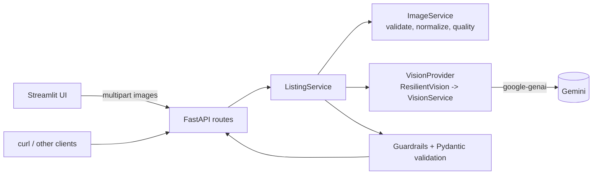
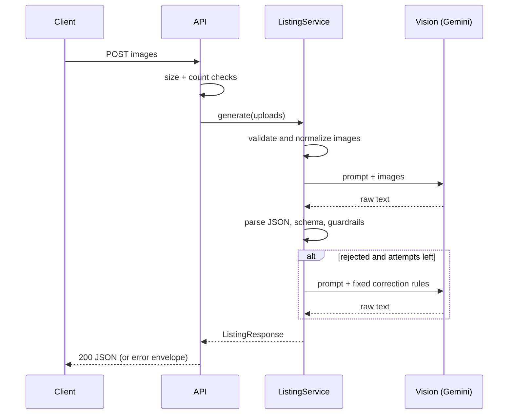
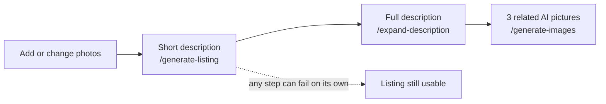

# SnapLot: AI Marketplace Listing Generator


Upload one or more photos of a product and get a **single, schema-validated marketplace listing**
(title, description, category, condition, features, tags). Built with FastAPI and Gemini Vision, with
a Streamlit UI on top.

The design goal is **honesty over fluency**: the service never invents specs, brands, accessories,
warranty or working condition, and it never returns model output that has not passed validation.

## What's new in 1.1
* **New brand and UI:** SnapLot, a clean responsive interface with a logo, loading states and a guided flow. No API address, key or settings panel is ever shown to users.
* **Short, then full description:** the listing starts with a short, verified description. The system can then expand it into a longer marketplace description (automatically or on a button), using only facts already in the listing.
* **Related AI pictures:** each time photos are added or changed, three related pictures are generated (studio view, alternate angle, in context). They are **always labelled "AI-generated"**, both in the UI and burned into the image, because they are illustrations, not photos of the real item.
* New endpoints `POST /api/v1/expand-description/` and `POST /api/v1/generate-images/`; both are optional and can be switched off.

## Features
* `POST /api/v1/generate-listing/`: 1-6 images (JPG/PNG/WEBP) of the *same* product -> one listing.
* Strict Pydantic output: fixed category and condition taxonomies, title <= 70 chars, 5-8 lowercase tags.
* Image pipeline: format sniffing, EXIF rotation, RGB flattening, resize to 1568 px, JPEG re-encode.
* Advisory quality checks (dark / blurry / low-res). If **every** image is poor, condition is forced to `Unable to Determine`.
* Deterministic guardrails on model text (hype, warranty, "fully functional", accessory claims, storage/RAM/battery numbers), with a retry that tells the model which rule it broke.
* Resilience: per-call timeout, overall request deadline, bounded retry on transient errors, concurrency cap.
* Uniform error envelope; no stack traces, provider messages or keys ever reach a client.
* Structured JSON logs with a per-request ID (`X-Request-ID`).

## Architecture


Only `VisionService` imports the Gemini SDK, so swapping providers means writing one class.

### Request flow


## How the UI flow works

Each stage shows its own loading state. If the full description or the pictures fail, the listing stays on screen with a retry button.

## Quick start (Windows PowerShell)
Requires Python 3.10+ and a Gemini API key from <https://aistudio.google.com/apikey>.

```powershell
git clone <your-repo-url> ai-marketplace-listing
cd ai-marketplace-listing
python -m venv .venv
.\.venv\Scripts\Activate.ps1
pip install -r requirements.txt
Copy-Item .env.example .env
notepad .env          # set GEMINI_API_KEY
python -m scripts.list_models   # optional: confirm which model names your key can use
```

macOS/Linux: `source .venv/bin/activate` and `cp .env.example .env`.

### Run the API
```powershell
uvicorn app.main:app --reload
```
Interactive docs: <http://127.0.0.1:8000/docs> | Health: <http://127.0.0.1:8000/health>

### Run the UI (second terminal)
```powershell
streamlit run streamlit_app/app.py
```
The UI uses `http://127.0.0.1:8000` by default; override with the `API_BASE_URL` environment variable or the sidebar.

### Keeping the service address private
The UI reads the API address from the `API_BASE_URL` environment variable (or Streamlit secret) and uses it only on the server. It is never rendered, and error messages never include it. For a deployed API, set `ENABLE_DOCS=false` to hide `/docs`, `/redoc` and `/openapi.json` as well.

### Call the API directly
```powershell
curl.exe -s -F "images=@sample_images\phone.jpg" -F "images=@sample_images\phone_back.jpg" http://127.0.0.1:8000/api/v1/generate-listing/
```
Keep the **trailing slash** (without it the server answers with a 307 redirect).

### Docker
```powershell
docker build -t listing-api .
docker run --rm -p 8000:8000 --env-file .env listing-api
```
The image contains no secrets; the key comes from `--env-file`. It runs as a non-root user and has a health check.
> The Dockerfile was written and reviewed but **could not be built in the authoring sandbox** (no Docker daemon). Please run the two commands above once and report any issue.

## API
Full schema: [`docs/openapi.json`](docs/openapi.json) (regenerate with `python -m scripts.export_openapi`).

**Success `200`**
```json
{
  "detected_item": "Samsung Tablet",
  "category": "Mobiles and Tablets",
  "condition_estimate": "Unable to Determine",
  "suggested_title": "Samsung Tablet - Silver",
  "suggested_description": "Silver tablet with a visible Samsung logo on the rear panel.",
  "extracted_features": ["Samsung logo on rear", "Silver back panel"],
  "tags": ["samsung", "tablet", "silver", "touchscreen", "android"]
}
```
Categories: Electronics, Mobiles and Tablets, Fashion, Vehicles, Home and Living, Tools and Industrial.
Conditions: Brand New, Like New, Used - Good Condition, Used - Fair Condition, Poor Condition, Unable to Determine.

**`POST /api/v1/expand-description/`** (JSON body = the listing fields) returns `{"long_description": "..."}`. The text may only use facts from the request; any number that was not in the input is rejected, and all listing guardrails apply.

**`POST /api/v1/generate-images/`** (same multipart `images` as above, optional form field `detected_item`) returns `{"images": [{"label", "mime_type", "data_base64", "ai_generated": true}], "notice": "..."}`. Partial results are returned if some pictures fail; an error is returned only if all fail.

**Errors** always look like `{"error": {"code", "message", "request_id"}}`:

| HTTP | code | Meaning |
|---|---|---|
| 400 | `invalid_image` | Missing, unreadable, corrupt or unsupported image, or too many images |
| 413 | `image_too_large` / `request_too_large` | A file or the whole request exceeds the limit |
| 422 | `no_product_detected` | The model found no sellable product (landscape, screenshot, ...) |
| 422 | `ai_output_invalid` | Model output failed schema/guardrails after all attempts |
| 429 | `vision_rate_limited` | Provider quota; `Retry-After: 30` is set |
| 503 | `vision_unavailable`, `vision_timeout`, `vision_empty_response`, `request_timeout` | Provider or deadline problem; retry |
| 503 | `vision_misconfigured` | Bad API key or model name (check `.env`) |

## Configuration
All settings are environment variables (or `.env`); see [`.env.example`](.env.example) for the full list.
Common ones: `GEMINI_API_KEY` (required), `GEMINI_MODEL`, `API_TIMEOUT` (per provider call, 60 s),
`REQUEST_TIMEOUT` (whole request, 110 s), `MAX_IMAGES_PER_REQUEST`, `MAX_IMAGE_SIZE_MB`,
`BLOCK_UNVERIFIED_SPECS`, `LOG_LEVEL`. New: `GEMINI_IMAGE_MODEL` (run `python -m scripts.list_models` to find an image-capable model your key can use), `GEMINI_TEXT_MODEL`, `ENABLE_IMAGE_GENERATION`, `ENABLE_DESCRIPTION_EXPANSION`, `RELATED_IMAGE_COUNT`, `WATERMARK_GENERATED_IMAGES`, `ENABLE_DOCS`.
Each related picture is a separate model call: turn `ENABLE_IMAGE_GENERATION` off or lower `RELATED_IMAGE_COUNT` to control cost.

## Edge cases and failure behaviour
Handled without crashing or inventing data (details and per-case results in [`evaluation/EDGE_CASES.md`](evaluation/EDGE_CASES.md)):
corrupt/truncated/zero-byte files, wrong extension or MIME, oversized files and dimensions, EXIF-rotated and
transparent images, blurry/dark/low-resolution images (condition downgraded), no-product images, multiple
products (dominant item only), provider outage, rate limiting, timeouts and empty responses.

## Testing
```powershell
pytest -q
```
208 tests; the vision provider is always mocked, so no key or network is needed.
Offline robustness check: `python -m scripts.edge_cases`.

## Evaluation
```powershell
python -m scripts.run_evaluation --dry-run   # which cases have images
python -m scripts.run_evaluation             # live run, writes evaluation/REPORT.md + results.json
```
See [`evaluation/REPORT.md`](evaluation/REPORT.md) for current results and limitations, and
[`evaluation/images/README.md`](evaluation/images/README.md) for the photos you need to supply.

## Demo
[`docs/DEMO.md`](docs/DEMO.md): a step-by-step 4-product demo including failure cases.

## Project layout
```
app/            FastAPI app: api/ (routes, errors, middleware), core/, models/, prompts/, services/
streamlit_app/  UI and its HTTP client
scripts/        baseline, samples, edge cases, evaluation, model listing, OpenAPI export
evaluation/     dataset, metrics, report, images
tests/          pytest suite
docs/           OpenAPI export, demo guide
```

## Security notes
* The key is a `SecretStr` read from the environment; it is never logged or returned. `.env` is git- and docker-ignored.
* Treat any text inside user photos as data: the prompt tells the model not to follow it. This reduces, but cannot eliminate, prompt-injection risk.
* There is no authentication or rate limiting in this service. Put it behind a gateway before exposing it publicly.

## Known limitations
* Generated pictures can invent unseen details (for example the back of a device). They are labelled as AI illustrations and must not be passed off as real photos of the item.
* The image model name and quota depend on your Gemini account; the default `gemini-3.6-flash-image` is unverified. If it is wrong, the UI shows that visuals are unavailable and the listing still works.
* One listing per request; photos of several different products are not split.
* Condition is an estimate from photos, and is often `Unable to Determine` for clean catalog-style shots.
* Quality thresholds were tuned on synthetic images; calibrate them on your own photos.
* Guardrails are regex-based and English-only.
